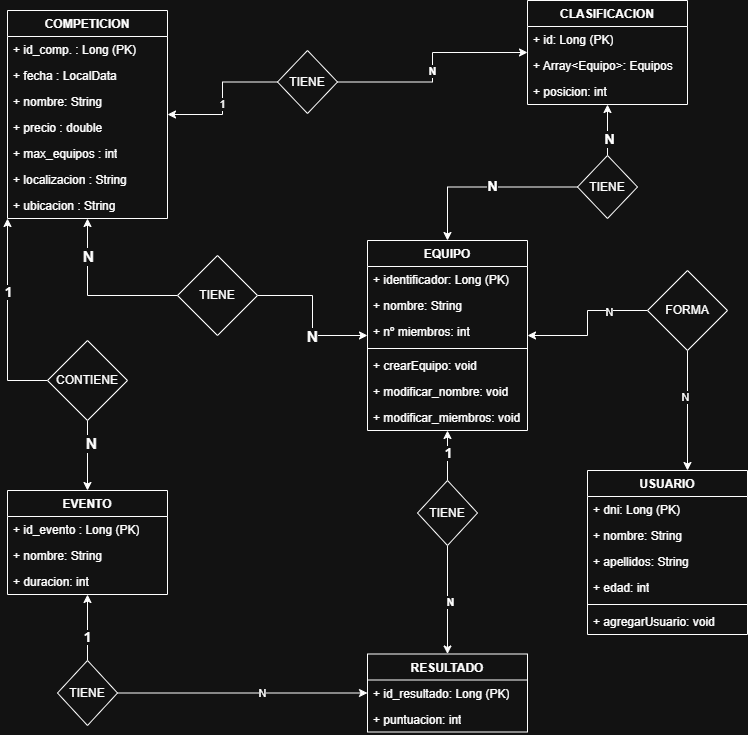
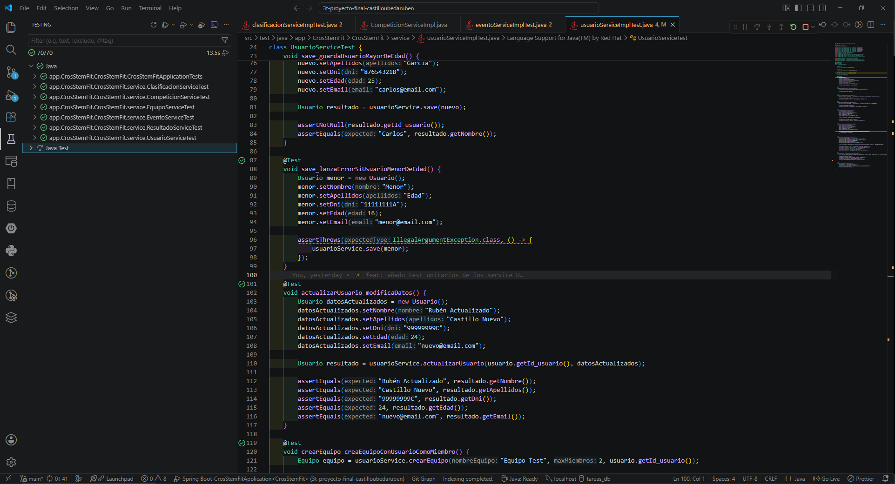

# 🏋️ CrosStemFit

Aplicación web para gestionar competiciones de CrossFit, desarrollada como proyecto final del primer curso de Desarrollo de Aplicaciones Web.

El objetivo del proyecto es construir una aplicación **full stack** sencilla pero completa, con un **backend en Spring Boot** y un **frontend en JavaScript puro**, donde se puedan administrar competiciones, equipos, usuarios, eventos, resultados y clasificaciones.

La aplicación permite simular el funcionamiento básico de una competición: crear atletas, formar equipos, registrar competiciones, añadir eventos o WODs, introducir resultados y consultar clasificaciones.

---

## 📌 Índice

- [🏋️ CrosStemFit](#️-crosstemfit)
  - [📌 Índice](#-índice)
  - [Descripción general](#descripción-general)
  - [Diagrama UML](#diagrama-uml)
  - [Tecnologías utilizadas](#tecnologías-utilizadas)
    - [Backend](#backend)
    - [Frontend](#frontend)
  - [▶️ Cómo ejecutar el proyecto](#️-cómo-ejecutar-el-proyecto)
    - [1. Clonar el repositorio](#1-clonar-el-repositorio)
    - [2. Arrancar el backend](#2-arrancar-el-backend)
    - [3. Abrir la aplicación web](#3-abrir-la-aplicación-web)
  - [Enlaces importantes](#enlaces-importantes)
  - [🧱 Estructura del backend](#-estructura-del-backend)
    - [Entity](#entity)
  - [Controllers](#controllers)
  - [Services](#services)
  - [💻 Estructura del frontend](#-estructura-del-frontend)
    - [api](#api)
    - [pages](#pages)
    - [components](#components)
    - [utils](#utils)
  - [🗄️ Base de datos H2](#️-base-de-datos-h2)
  - [📘 Swagger](#-swagger)
  - [✅ Tests](#-tests)
  - [📄 Documentación JavaDoc](#-documentación-javadoc)
  - [Conclusión](#conclusión)
  - [Enlace vídeo](#enlace-vídeo)

---

##  Descripción general

**CrosStemFit** está pensado como una plataforma para organizar competiciones de CrossFit.

La aplicación permite gestionar las partes principales de una competición:

- Usuarios que participan como atletas.
- Equipos formados por varios usuarios.
- Competiciones con fechas, ubicación, precio y límite de equipos.
- Eventos o pruebas dentro de cada competición.
- Resultados obtenidos por los equipos en cada evento.
- Clasificaciones con puesto y puntos totales.

El proyecto está dividido en dos partes principales:

| Parte | Descripción |
|---|---|
| Backend | API REST desarrollada con Java y Spring Boot |
| Frontend | Interfaz web creada con HTML, CSS, JavaScript y Bootstrap |

El flujo principal sería:

```text
Crear usuarios → Crear equipos → Crear competición → Añadir eventos → Añadir resultados → Consultar clasificación
```

---

##  Diagrama UML

El proyecto se basa en varias entidades relacionadas entre sí.



---

## Tecnologías utilizadas

### Backend

- Java
- Spring Boot
- Maven
- Spring Data JPA
- H2 Database
- Java Faker
- JUnit 5
- JavaDoc
- Swagger 

### Frontend

- HTML
- CSS
- JavaScript puro
- Bootstrap
- Bootstrap Icons
- Fetch API

---

## ▶️ Cómo ejecutar el proyecto

### 1. Clonar el repositorio

```bash
git clone https://github.com/STEMgranada-1DAW-2526/3t-proyecto-final-castilloubedaruben.git
```

Entrar en la carpeta del proyecto:

```bash
cd 3t-proyecto-final-castilloubedaruben
```

---

### 2. Arrancar el backend

En Windows con PowerShell:

```bash
.\mvnw.cmd spring-boot:run
```

En Git Bash o Linux:

```bash
./mvnw spring-boot:run
```

Si tienes Maven instalado en el sistema:

```bash
mvn spring-boot:run
```

---

### 3. Abrir la aplicación web

Una vez iniciado Spring Boot, se puede acceder a la página principal desde:

[http://localhost:8080/index.html](http://localhost:8080/index.html)

---

##  Enlaces importantes

| Recurso | Enlace |
|---|---|
| Página principal | [http://localhost:8080/index.html](http://localhost:8080/index.html) |
| Swagger | [http://localhost:8080/swagger-ui/index.html#/](http://localhost:8080/swagger-ui/index.html#/) |
| Consola H2 | [http://localhost:8080/h2-console/login.jsp](http://localhost:8080/h2-console/login.jsp) |

---

## 🧱 Estructura del backend

El backend sigue una estructura por capas. La idea es separar responsabilidades para que el código sea más claro y fácil de mantener.

```text
src/main/java/app/CrosStemFit/CrosStemFit
│
├── controller
├── service
├── service/impl
├── repository
├── entity
└── config
```

### Entity

Las entidades representan las tablas principales de la base de datos:

- `Usuario`
- `Equipo`
- `Competicion`
- `Evento`
- `Resultado`
- `Clasificacion`

Entre ellas existen relaciones importantes:

- Un usuario puede pertenecer a varios equipos.
- Un equipo puede tener varios usuarios.
- Un equipo puede participar en varias competiciones.
- Una competición puede tener varios eventos.
- Un evento puede tener varios resultados.
- Una competición puede tener varias clasificaciones.

---

##  Controllers

Los controllers son la entrada principal de la API REST.

Su función es recibir las peticiones HTTP del frontend, Postman o Swagger, y pasarlas al service correspondiente.  
No contienen la lógica fuerte del proyecto, sino que actúan como una capa intermedia de comunicacion entre el cliente y la lógica.

Ejemplo de rutas principales:

```text
/api/v1/usuarios
/api/v1/equipos
/api/v1/competiciones
/api/v1/eventos
/api/v1/resultados
/api/v1/clasificaciones
```

Cada controller tiene endpoints CRUD básicos como son:

- `GET` para consultar información.
- `POST` para crear nuevos registros.
- `PUT` para modificar datos.
- `DELETE` para eliminar registros.

También hay endpoints específicos para relaciones entre entidades. Por ejemplo:

```text
GET /api/v1/usuarios/{id}/equipos
GET /api/v1/equipos/{id}/miembrosEquipo
GET /api/v1/equipos/{id}/clasificaciones
GET /api/v1/competiciones/{id}/eventos
GET /api/v1/competiciones/{id}/clasificaciones
GET /api/v1/eventos/{id}/resultados
POST /api/v1/equipos/{idEquipo}/miembros/{idUsuario}
POST /api/v1/competiciones/{id}/eventos/{idEvento}
POST /api/v1/eventos/{id}/resultados
```

Esto permite que la aplicación no se limite a hacer CRUD básico, sino que también pueda representar acciones reales del proyecto, como añadir miembros a un equipo, registrar eventos en una competición o consultar una clasificación.

---

##  Services

Los services son una de las partes más importantes del backend.

Aquí está la lógica principal de la aplicación.  
Los controllers llaman al service y el service decide qué hacer con los datos usando los repositories.

Ejemplos de lógica que se gestiona en los services:

- Validar que un usuario sea mayor de edad antes de guardarlo.
- Crear un equipo y asignarle un usuario como miembro inicial.
- Añadir miembros a un equipo.
- Comprobar que un equipo no supere el número máximo de miembros.
- Registrar equipos en una competición.
- Evitar que un equipo se registre dos veces en la misma competición.
- Comprobar si una competición está completa.
- Añadir eventos a una competición.
- Añadir resultados a un evento.
- Ordenar los resultados de un evento por puntuación.
- Modificar puntuaciones.
- Consultar clasificaciones, miembros, resultados y relaciones entre entidades.

La estructura usada es:

```text
Controller → Service → Repository → Base de datos
```

---

## 💻 Estructura del frontend

El frontend está desarrollado con HTML, CSS, JavaScript puro y Bootstrap.

La estructura está organizada en carpetas:

```text
js/
│
├── api
├── components
├── pages
└── utils
```

### api

Contiene los archivos encargados de hacer las peticiones al backend con `fetch`.

Ejemplos:

- `usuarioAPI.js`
- `equipoAPI.js`
- `competicionAPI.js`
- `eventoAPI.js`
- `resultadoAPI.js`
- `clasificacionAPI.js`

### pages

Contiene la lógica JavaScript de cada pantalla.

Ejemplos:

- `usuariosLista.js`
- `usuarioDetalle.js`
- `equiposLista.js`
- `equipoDetalle.js`
- `competicionesLista.js`
- `competicionDetalle.js`
- `eventosLista.js`
- `eventoDetalle.js`

### components

Contiene partes reutilizables de la interfaz, como la barra de navegación o tarjetas de información.

### utils

Contiene funciones auxiliares, como la función general para hacer peticiones a la API.

---

## 🗄️ Base de datos H2

El proyecto usa H2 como base de datos.

Para acceder:

[http://localhost:8080/h2-console/login.jsp](http://localhost:8080/h2-console/login.jsp)

Datos de conexión:

```text
JDBC URL: jdbc:h2:mem:CrosStemFit_db
User Name: sa
Password:
```

La contraseña se deja vacía.

Desde la consola H2 se pueden ver las tablas generadas por JPA y comprobar los datos cargados por el proyecto.

---

## 📘 Swagger

Swagger permite ver y probar los endpoints de la API desde el navegador.

Enlace:

[http://localhost:8080/swagger-ui/index.html#/](http://localhost:8080/swagger-ui/index.html#/)

Desde Swagger se pueden probar las principales operaciones de la API, como:

- Crear usuarios.
- Crear equipos.
- Consultar competiciones.
- Añadir eventos.
- Añadir resultados.
- Consultar clasificaciones.

---

## ✅ Tests

El proyecto incluye tests con JUnit 5 para comprobar el funcionamiento de los services.

Se han probado los services principales:

- `UsuarioService`
- `EquipoService`
- `CompeticionService`
- `EventoService`
- `ResultadoService`
- `ClasificacionService`

Para ejecutar los tests:

En Windows:

```bash
.\mvnw.cmd test
```

En Git Bash o Linux:

```bash
./mvnw test
```

Imagen de los tests funcionando:



---

## 📄 Documentación JavaDoc

El proyecto también incluye documentación JavaDoc.

Para generarla:

En Windows:

```bash
.\mvnw.cmd javadoc:javadoc
```

En Git Bash o Linux:

```bash
./mvnw javadoc:javadoc
```

La documentación se genera normalmente en:

```text
target/site/apidocs/index.html
```

---

##  Conclusión

CrosStemFit es una aplicación pensada para demostrar el uso conjunto de backend, frontend, base de datos, API REST, documentación y tests.

El proyecto incluye CRUD completo, relaciones entre entidades, lógica de negocio en los services y una interfaz visual construida con JavaScript puro y Bootstrap.

La parte más importante no es solo crear y borrar datos, sino cómo se relacionan entre sí: usuarios dentro de equipos, equipos dentro de competiciones, eventos dentro de competiciones y resultados que acaban formando una clasificación.

## Enlace vídeo

[https://youtu.be/bZV0j81guds](https://youtu.be/bZV0j81guds)


